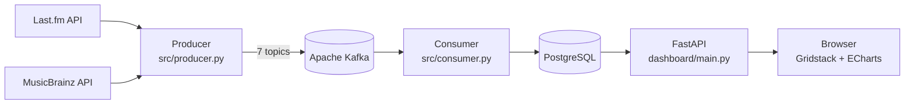

# Music API Dashboard

A music analytics project that streams **Last.fm** data through **Apache Kafka** into
**PostgreSQL** and lets you build your own dashboards with drag and drop.

Examples of questions it answers:

- Which genres does each country listen to?
- How popular are a country's artists abroad? What share of their listeners is foreign?
- In which countries is a given artist listened to, and by how many people?
- How many hours have the top songs been played in total (estimated)?

> The dashboard user interface is in Turkish.

<!-- Screenshot: add an image to docs/ and remove the comment markers from the next line -->
<!--  -->

## Architecture



- **Producer:** fetches global charts (artists, tracks, tags), the top 200 artists and top
  50 tracks of 17 countries, artists' genre tags from Last.fm, and artists' home countries from
  MusicBrainz. Every record is sent to Kafka with a timestamp. Runs once or on an interval
  (`--loop`).
- **Consumer:** writes Kafka messages to PostgreSQL. Offsets are committed only after the
  database write succeeds (at-least-once); primary keys prevent duplicate rows when a message
  is delivered twice.
- **Dashboard:** a FastAPI backend with a lightweight HTML/JS front end. Dashboards are stored
  in the database.

Every fetch is stored as a *snapshot*, so changes can be tracked over time.

## Features

- **Drag-and-drop dashboards:** drag widgets from the library onto the board, move and resize
  them. Changes are saved automatically. Multiple dashboards, JSON export and import.
- **Dashboard filters:** add country, artist or genre filters above the board and bind widgets
  to them; bound widgets update together when the selection changes. Single or multi-select.
  Clicking a bar sets the matching filter. Titles can use placeholders such as `{{country}}`.
- **18 ready-made widget templates:** country top charts, genre distribution, country × genre
  heatmap, foreign listener share, foreign markets, artist summary, estimated listening time,
  artist trend and more.
- **Custom query builder:** choose the data source, X axis, series, measure and filters.
  Supports ratios (A ÷ B with conditional aggregates) and shares (percent of total, of group
  or of series).
- **SQL widget:** write your own `SELECT` query and turn the result into a chart. Dashboard
  filters can be used in the query as `{{country}}`.
- **Artist home countries:** needed for the foreign-share metrics. Taken from MusicBrainz;
  if not found, the country where the artist has the most listeners is used. Can be corrected
  manually in the UI.
- 10 chart types (bar, stacked bar, line, donut, treemap, heatmap, table, KPI tiles…), light
  and dark themes, responsive layout.

## Tech stack

Python 3.10+ · Apache Kafka 3.8 (KRaft) · PostgreSQL 16 · FastAPI · psycopg 3 ·
confluent-kafka · Gridstack.js · Apache ECharts · Docker Compose

## Getting started

### Prerequisites

- Python 3.10 or newer
- [Docker Desktop](https://www.docker.com/products/docker-desktop/)
- A Last.fm API account: <https://www.last.fm/api/account/create>

### 1. Clone the repository and create the config file

```bash
git clone https://github.com/ArdaCemBilecan/MusicAPIDashboard.git
cd MusicAPIDashboard
cp .env.example .env          # Windows PowerShell: Copy-Item .env.example .env
```

Open `.env` and fill in your values:

| Variable | Description |
|---|---|
| `LASTFM_API_KEY` | Your Last.fm API key |
| `LASTFM_SHARED_SECRET` | Last.fm shared secret (not used by this project, can be left empty) |
| `POSTGRES_PASSWORD` | Database password (choose any) |
| `MUSICBRAINZ_CONTACT` | Your e-mail address or website; MusicBrainz asks for contact info in requests |

> `.env` is listed in `.gitignore` and is never committed.

### 2. Start Kafka and PostgreSQL

```bash
docker compose up -d
```

| Service | Address |
|---|---|
| Kafka | `localhost:9092` |
| Kafka UI | <http://localhost:8080> |
| PostgreSQL | `localhost:5432` |
| Adminer (database UI) | <http://localhost:8081> |

### 3. Install the Python dependencies

```bash
python -m pip install -r requirements.txt
```

### 4. Fetch the data

Open two terminals:

```bash
# Terminal 1: reads from Kafka and writes to the database (keep it running)
cd src
python consumer.py
```

```bash
# Terminal 2: fetches data from Last.fm and MusicBrainz
cd src
python producer.py                   # run once
python producer.py --loop            # repeat every hour
python producer.py --skip-tags       # quick test: skip genre tags
python producer.py --skip-countries  # skip the MusicBrainz step
```

The first run can take a while because of genre tags and artist countries; later runs are
much faster thanks to the cache in `data/`. MusicBrainz allows one request per second, so each
run looks up at most 500 artists' countries and the rest are picked up by later runs.

### 5. Open the dashboard

From the project root:

```bash
python -m uvicorn dashboard.main:app --reload
```

Go to <http://localhost:8000>. Sample dashboards are created on first start.

### 6. Daily scheduled fetch (optional)

A ready-made cron entry and script fetch the data automatically every day. They are meant for
a server where the consumer and the Docker Compose services run continuously.

**Linux / macOS (cron):** `deploy/crontab` runs `scripts/daily_fetch.sh` every day at 03:15
(Europe/Istanbul time).

```bash
chmod +x scripts/daily_fetch.sh
# replace the project path in deploy/crontab with your own, then:
crontab deploy/crontab      # if you already have cron jobs, add the line with crontab -e instead
crontab -l                  # verify
```

The script:

- runs the producer (using the project's `.venv` if there is one),
- writes the output to `logs/fetch_YYYY-MM-DD.log` and deletes logs older than 30 days,
- skips the run if the previous fetch is still in progress.

Extra producer arguments can be passed with the `PRODUCER_ARGS` environment variable
(e.g. `PRODUCER_ARGS="--skip-tags"`).

**Windows (Task Scheduler):** `scripts/daily_fetch.ps1` does the same. How to register the task
is described at the top of the file.

> Scheduling is deliberately not done with GitHub Actions: the fetch has to run on a machine
> that can reach Kafka and PostgreSQL.

## Usage

- Click **Düzenle** (Edit) to enter edit mode. Drag or click a widget in the library on the
  left, then choose its parameters and chart type in the settings window; a live preview is
  shown on the right.
- Use **Filtre ekle** (Add filter) to add a filter above the board. In a widget's settings,
  choose "Filtreye bağlı" (bound to filter) next to a parameter to bind it.
- In the **SQL widget**, filters are referenced as `{{name}}`:

  ```sql
  SELECT artist_name, foreign_share_pct
  FROM v_artist_foreign_share
  WHERE home_country = {{country}}           -- single-select filter
  -- WHERE home_country = ANY({{countries}}) -- multi-select filter
  ORDER BY 2 DESC
  LIMIT 15
  ```

- Artists' home countries can be corrected in the 🌐 **Sanatçı ülkeleri** (Artist countries)
  window in the top bar.

### How is the foreign share calculated?

```
foreign share = foreign listeners ÷ (domestic listeners + foreign listeners)
```

For example, if an artist has 90 listeners in Turkey and 10 in Germany, the foreign share is
10%. An artist's home country is determined in this order: manual entry → MusicBrainz → the
country where the artist has the most listeners (estimated).

## Data model

| Table / view | Contents |
|---|---|
| `geo_top_artists`, `geo_top_tracks` | Top charts per country (snapshots) |
| `chart_top_artists`, `chart_top_tracks`, `chart_top_tags` | Global charts (snapshots) |
| `artist_tags` | Artist → genre tags |
| `countries` | ISO country codes and Last.fm country names |
| `artist_country`, `artist_country_override` | Home countries from MusicBrainz and manual entries |
| `v_artist_home` | Each artist's home country and its source |
| `v_artist_country_listeners` | Listeners per artist × country, split into domestic / foreign |
| `v_artist_foreign_share` | Foreign share summary per artist |
| `dashboards` | Saved dashboards (widgets and filters, JSONB) |

Settings (country list, number of records to fetch, cache durations) are in `src/config.py`.

## Security notes

- API keys and passwords are kept only in `.env`, which is never committed.
- The custom query builder only uses whitelisted tables and columns; all values are passed as
  SQL parameters.
- The SQL widget accepts a single `SELECT`/`WITH` statement. It runs in a read-only
  transaction under a database role that can only read data. Dangerous functions are blocked,
  with a 5-second timeout and a 1,000-row limit. Filter values are passed as parameters, not
  inserted into the query text.
- The app is designed for local use and has no user authentication. Put an authentication
  layer in front of it before exposing it on a public server.

## Known limitations

- Last.fm's country charts only include the most-listened artists in each country. If an
  artist is not in another country's top 200, their listeners there are not visible, so
  foreign shares can be underestimated, especially for artists from smaller markets.
- The foreign share can only be calculated when the artist's home country is one of the 17
  tracked countries.
- "Estimated listening time" is an approximation: play count × track duration.

## Troubleshooting

- **`uvicorn` is not recognized (Windows):** run the commands through `python -m`:
  `python -m uvicorn dashboard.main:app --reload`, `python -m pip install ...`
- **`No module named dashboard`:** start uvicorn from the project root, not from `src`.
- **Connection / DNS errors in the producer:** check your internet connection. The producer
  retries automatically after short outages; missing data is filled in on the next run.
- **Resetting the database:** `docker compose down -v` (deletes all data).

## Project structure

```
├── docker-compose.yml      Kafka, Kafka UI, PostgreSQL, Adminer
├── requirements.txt
├── .env.example            Config template (copy to .env)
├── sql/schema.sql          Tables and views
├── scripts/                Daily fetch scripts (daily_fetch.sh, daily_fetch.ps1)
├── deploy/crontab          Cron entry for the daily fetch
├── src/                    Data pipeline
│   ├── producer.py         Last.fm / MusicBrainz → Kafka
│   ├── consumer.py         Kafka → PostgreSQL
│   ├── lastfm_client.py    Last.fm client (rate limiting, retries)
│   ├── musicbrainz.py      Looks up artists' home countries
│   ├── transforms.py       Turns API responses into records
│   ├── config.py           Settings
│   └── test_connection.py  Last.fm connection test
└── dashboard/              Web application
    ├── main.py             FastAPI app and API
    ├── templates.py        Ready-made widget templates
    ├── builder.py          Custom query builder
    ├── sqlrunner.py        SQL widget
    ├── variables.py        Dashboard filters
    ├── storage.py          Saved dashboards and samples
    └── static/             Front end (HTML, CSS, JS and libraries)
```

## License

Released under the [MIT License](LICENSE).

Third-party libraries and their licenses are listed in
[THIRD_PARTY_NOTICES.md](THIRD_PARTY_NOTICES.md). Data is provided by
[Last.fm](https://www.last.fm/api) and [MusicBrainz](https://musicbrainz.org/).
